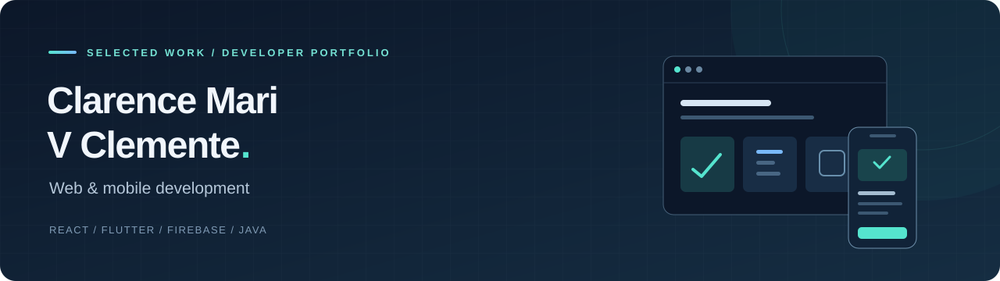

  

  <strong>IT student at Bulacan State University</strong> 
  Building practical applications for the web, mobile, and everyday workflows.

  <a href="#selected-projects">Selected projects</a> &nbsp;·&nbsp;
  <a href="#technologies">Technologies</a> &nbsp;·&nbsp;
  <a href="https://github.com/yenzclemente-blip?tab=repositories">Explore repositories</a>

---

### About me

I'm **Clarence**, an Information Technology student specializing in **Web and Mobile Development**. My projects explore how software can make reporting, tracking, and managing information easier—from a shared road accident reporting workflow to a Java café management system.

I work with **React, Flutter, Firebase, and Java**, with a focus on clear interfaces, organized application logic, and useful features.

### Selected projects

#### 01 &nbsp; ActSeeDeal

**Road accident reporting & case management** &nbsp; / &nbsp; University team prototype

A web and Android application that connects incident reporting with staff review and case resolution through an **Act → See → Deal** workflow.

- Incident reports with location details and photo evidence.
- Staff review, officer assignment, progress tracking, and notifications.
- Shared Firebase backend for the React portal and Flutter Android app.

**Built with:** React · JavaScript · Flutter · Dart · Firebase

Private repository. Featured here as a project summary; source code is not publicly available.

---

#### 02 &nbsp; Track-and-Trace

**Campus lost & found management** &nbsp; / &nbsp; Academic team project

A responsive web application for Bulacan State University that brings lost-item reports, found-item matching, ownership claims, and administrator verification into one workflow.

- Lost and found reports, suggested matches, and claim tracking.
- Proof-of-ownership review and item release workflows.
- My contributions include report photo previews, editable reference settings, mobile role filters, and verification email improvements.

**Built with:** Next.js · TypeScript · Tailwind CSS · MySQL

[Explore source code →](https://github.com/l3n8n-ocd/track-and-trace) &nbsp;·&nbsp; [View my contributions →](https://github.com/l3n8n-ocd/track-and-trace/commits/main/?author=yenzclemente-blip)

Collaborative project hosted in the team's repository. See its README for full team credits.

---

#### 03 &nbsp; Café Inventory & Order Management

**Console-based business workflow** &nbsp; / &nbsp; Academic team project

A Java application for managing café products, supplies, recipes, suppliers, and customer orders, with separate administrator and staff workflows.

- Product and supply management with add, search, update, and delete operations.
- Recipe, supplier, supply delivery, and ordering modules.
- Object-oriented structure using inheritance, abstraction, and Java collections.

**Built with:** Java · Object-oriented programming · Console UI

[Explore source code →](https://github.com/yenzclemente-blip/OOP_IM_Project_ver2)

Team project maintained as a fork of <a href="https://github.com/Francisco-HM06/OOP_IM_Project_ver2">Francisco-HM06/OOP_IM_Project_ver2</a>.

### Technologies

| Area | Technologies used in my projects |
| :--- | :--- |
| Web | React, Next.js, JavaScript, TypeScript, HTML, CSS, Tailwind CSS, Vite |
| Mobile | Flutter, Dart |
| Backend & data | Firebase Authentication, Cloud Firestore, MySQL |
| Programming foundations | Java, object-oriented programming |
| Development workflow | Git, GitHub |

---

  <strong>Practical problems. Thoughtful interfaces. Continuous learning.</strong> 
  Thanks for exploring my work.

